# The Gathering Place

**Attendance for the YSA vocational classes at The Gathering Place: students sign themselves up, an admin reviews them, and teachers take the register on their phones, even with patchy signal.**

The Gathering Place replaces paper registers with one live record. Students join a class from a public link or QR code and get a reference code to check their status. The admin accepts or declines each sign-up, sets up classes and semesters, and sees every class's attendance as it comes in. Teachers mark Present or Absent for each student in a few taps, and nothing is lost if the signal drops halfway through.

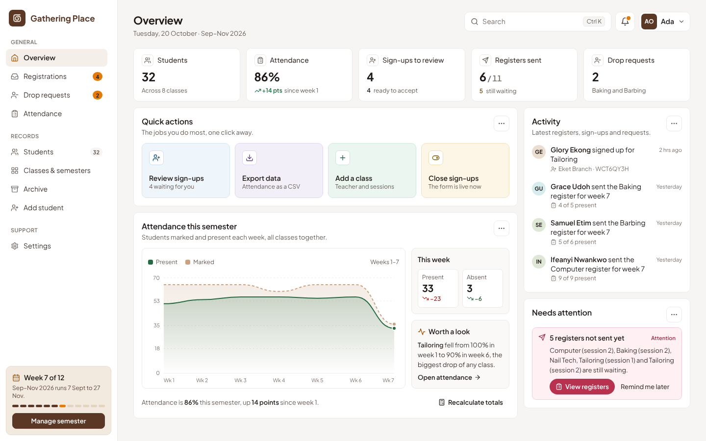

## Why it works for the YSA classes

- **Built for teachers' phones.** Large Present and Absent buttons, "mark the rest" shortcuts and a sticky Send bar. Marks are saved on the phone as they're made, so closing the page or losing signal keeps them until they're sent.
- **Students sign themselves up.** A public form at `/join`, shared as a link or QR code. One person per phone number, however the number is written, and returning students are linked to their earlier record.
- **The admin sees everything at once.** Which registers each class has sent this week, attendance by week, sign-ups and drop requests waiting, and what needs attention.
- **Nothing is ever thrown away.** Ending a semester archives each class's students and attendance, so past semesters stay readable and exportable.
- **Free to run.** Everything runs on Firebase's free Spark plan (Hosting, Authentication and Firestore) with no server code. Pages read only what they show, to stay well inside the daily quota.
- **Safe by design.** Who can read and write what is enforced by Firestore security rules, which are tested in CI before they reach production.

## Features

### Sign-ups
- A public sign-up form: name, phone number, optional gender, ward or branch and email, and one or two classes. Students get a reference code to check their status at `/status`, and can send it to themselves on WhatsApp.
- The admin reviews each sign-up under **Registrations**: accept or decline one at a time or in bulk. A decline reason stays private unless the admin chooses to show it on the student's status page.
- `0803 123 4567`, `+234 803 123 4567` and `2348031234567` count as the same number, and a number can't be used twice.
- **Invite students** shows a QR code and link to the form, optionally with a class picked in advance, to print or share on WhatsApp.
- Sign-ups can be paused from Settings with a message for anyone who opens the form. Spam protection: a honeypot field, strict rules for signed-out writes, and Firebase App Check with reCAPTCHA v3 when configured.

### Taking the register
- Each teacher sees only their own class. This week opens by default, and teachers can step back to catch up on an earlier week.
- With more than one session a week, each session shows whether it's sent, still to do, or had no class.
- A session can be marked as **no class**, which leaves it out of every attendance rate.
- The app keeps an offline copy of the class, and marks sent without signal are delivered when it returns.
- Teachers can see each student's attendance rate and ask the admin to drop a student, then follow the decision.

### Students
- A searchable student list, filtered by class, with a CSV export.
- Admins can also add a student directly under **Add student**, which skips review and lists the latest registrations beside the form.
- A profile for each student: attendance for each class this semester, every session they were marked for, their details, how they joined, and a QR code. Details can be edited from the profile.
- Search from any page (Ctrl K) finds students by name or phone number.

### Classes and semesters
- Add a class with a name and colour, and set its semester dates, sessions per week and teacher. Every class keeps its colour across chips, cards and charts.
- Removing a class is guarded: a class with history is retired instead of deleted, and can be restored.
- Each class runs its own semester. Week numbers count from the semester's start, so Week 1 is always the first week of the intake.
- At the end of a semester, archive each class to clear its register for the next intake. Archived students and attendance stay browsable and exportable.

### Administration
- **Overview:** headline numbers, quick actions, an activity feed of registers, sign-ups and requests, attendance by week, and a list of what needs attention, such as registers not yet sent.
- **Attendance:** one class and week at a time as a register grid, and a semester's attendance as a CSV.
- **Drop requests:** approve, or decline with a note the teacher sees. A dropped student's past attendance is kept.
- **Settings:** open or pause sign-ups, and add staff, change their roles and classes, or remove their access. New staff get an email to set their own password.
- A person can be both an admin and a teacher of one class.

## Screenshots

All screenshots use made-up demo data. No real student or teacher appears in them.

| Students | Student profile |
| --- | --- |
| 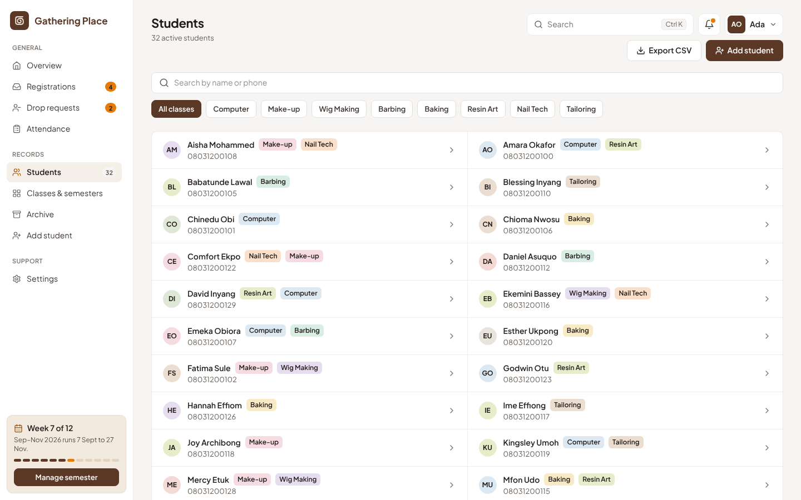 | 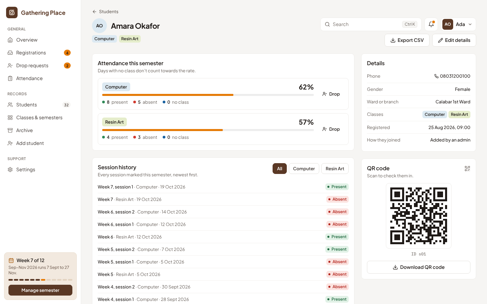 |
| 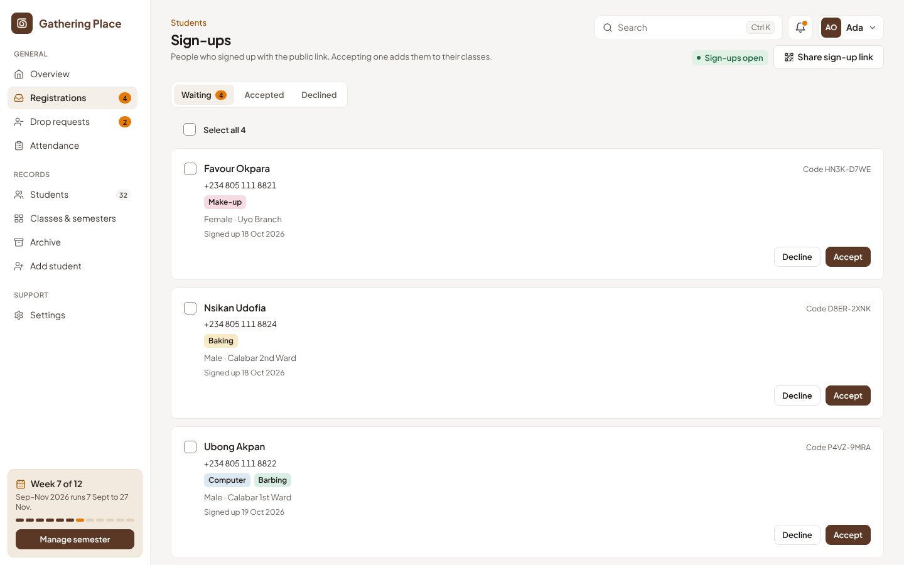 | 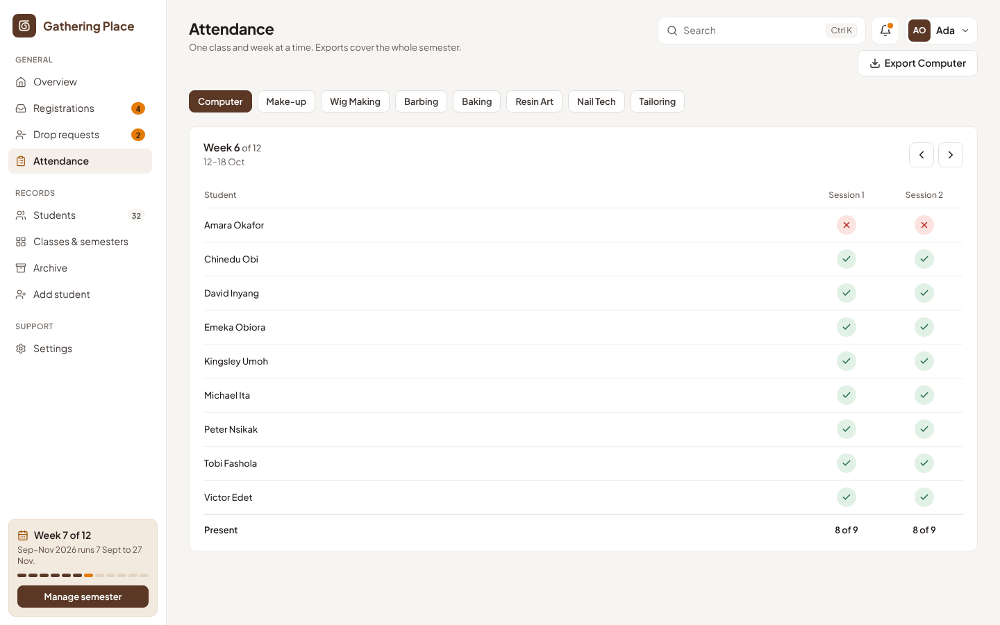 |
| 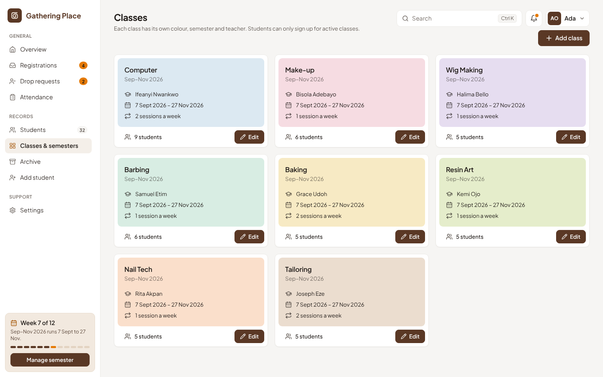 | 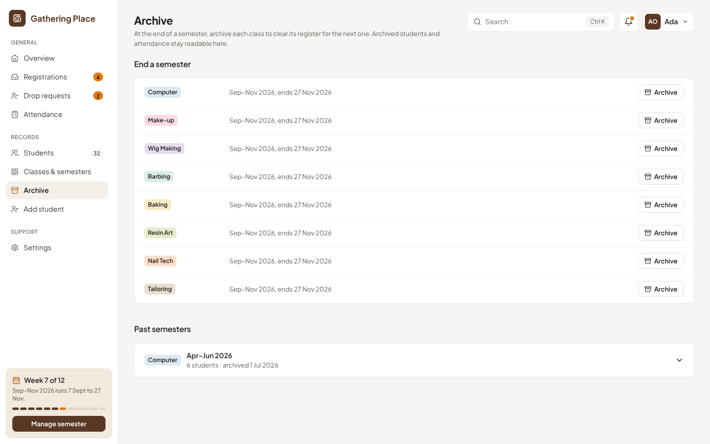 |
| 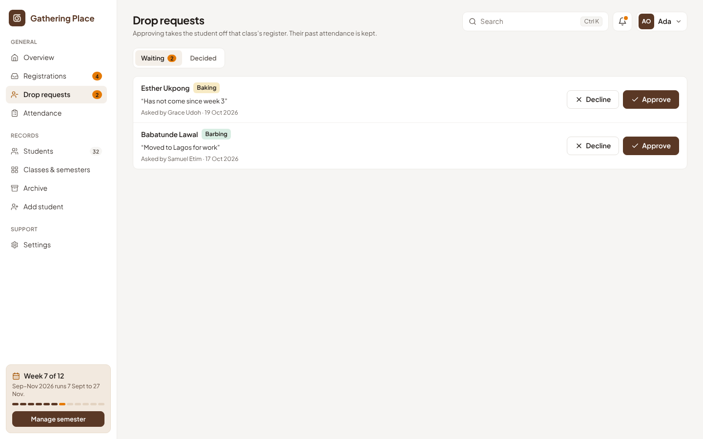 | 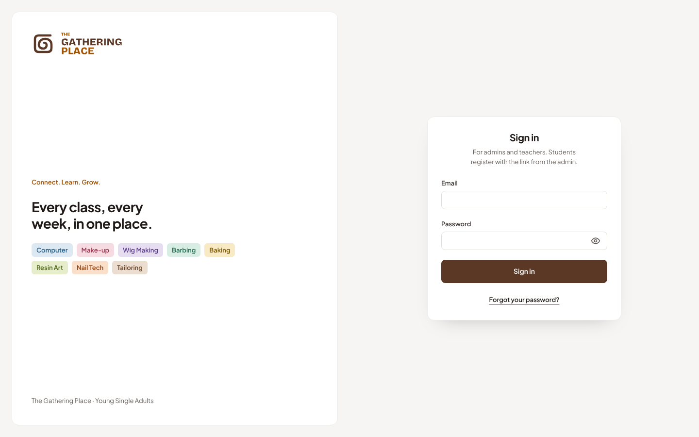 |

On a phone:

| Teacher's register | Admin overview | Sign-up form | Sign-up status |
| --- | --- | --- | --- |
| 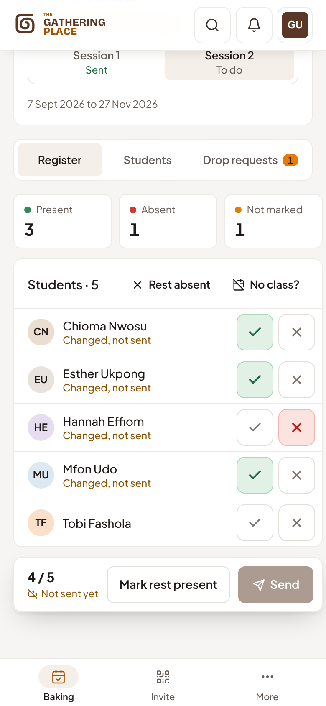 | 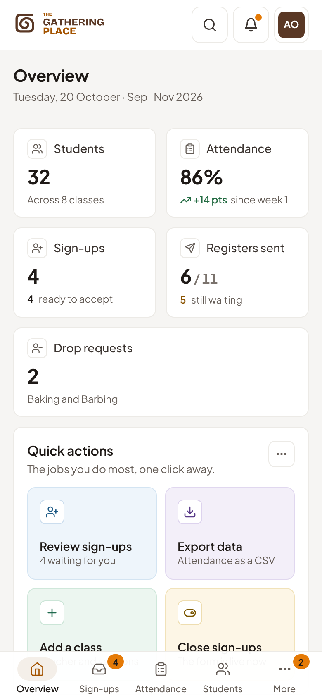 | 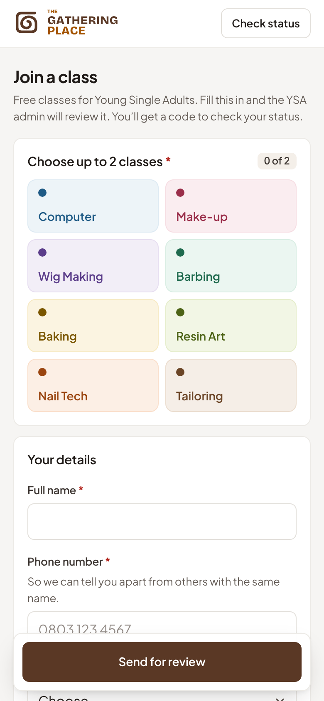 | 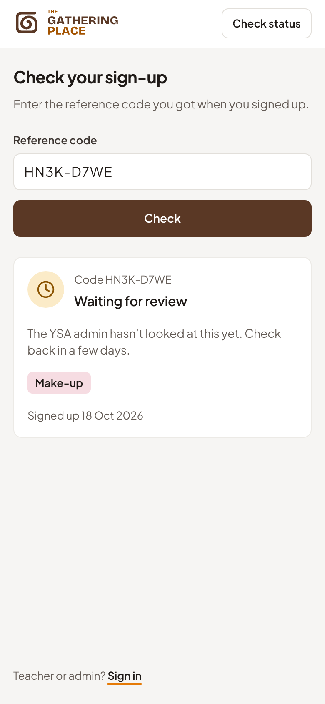 |

## How it fits together

The app is a React single-page app talking straight to Firebase:

- **Hosting** serves the built site. Every pull request also gets a preview link.
- **Authentication** signs in staff. Students never have accounts; they only use the public sign-up and status pages.
- **Firestore** holds all the data, with a persistent offline cache in the browser and live listeners, so pages update as registers come in.

There are no Cloud Functions. Everything the server must guarantee (who can write what, one sign-up per phone number, totals that add up) is enforced by the security rules. Teachers write each session's totals alongside the register, so the admin overview reads one small document per session instead of every record.

```
Browser (React SPA)
    ├── React Router     → Lazy-loaded pages and role guards
    ├── Zustand          → Signed-in user and role; the live class list
    └── Firebase SDK
          ├── Authentication  → Sign-in; a second app instance creates staff accounts
          ├── App Check       → reCAPTCHA v3, when configured
          └── Firestore       → Offline cache, listeners and batched writes
```

What each collection holds and who can read it: [docs/data-model.md](docs/data-model.md).

## Quick start (development)

Node.js 22 (see `.nvmrc`) and npm.

```bash
npm install
cp .env.example .env   # fill in your Firebase web app values
npm run dev
```

Open http://localhost:5173. Staff sign in with an account an admin creates; the first admin is made by hand ([docs/setup.md](docs/setup.md#6-create-the-first-admin-account)).

To work without a Firebase project, run the local emulators and point the app at them:

```bash
npm run emulators                       # Auth and Firestore on this computer
VITE_USE_EMULATORS=true npm run dev
```

The design system is documented live at `/styleguide`.

### Tests

```bash
npm run check        # lint, type-check, unit tests and a production build
npm run test:rules   # security rules tests against the Firestore emulator (needs Java 21+)
```

GitHub Actions runs all of these on every pull request and every push to `main`, then deploys `main` to production.

| Command | What it does |
|---|---|
| `npm run dev` | Development server with hot reload |
| `npm run build` | Production build into `dist/` |
| `npm run preview` | Serve the production build locally |
| `npm run lint` | ESLint |
| `npm run typecheck` | TypeScript type-check |
| `npm test` | Unit tests (Vitest) |
| `npm run test:rules` | Security rules tests |
| `npm run emulators` | Local Auth and Firestore emulators |

## Deployment

`main` deploys to Firebase Hosting, together with `firestore.rules` and `firestore.indexes.json`, after CI passes. The site is at `https://gathering-place-d03e7.web.app`. Netlify is still connected while the move to Firebase Hosting finishes.

Creating a Firebase project, environment variables, the GitHub secrets the deploy needs, upgrading an existing install, and wiping the data to start over: [docs/setup.md](docs/setup.md).

## Tech stack

React 18 · TypeScript (gradual) · Vite 5 · Tailwind CSS 3 · Zustand · React Router 6 · Firebase Authentication, Firestore and Hosting · Radix UI · Motion · Lucide icons · qrcode.react · PapaParse for CSV · react-hot-toast · Bricolage Grotesque, Plus Jakarta Sans and Space Mono.

## Security

- **Rules on the server.** Route guards in the app are a convenience; Firestore security rules reject anything a user isn't allowed to do, whatever the app shows.
- **Class isolation.** Teachers read and write only their own class's students and attendance, and only as themselves.
- **Shaped public writes.** A sign-up is three documents checked against each other: the same reference code, a valid phone number, active classes, sign-ups open, and no existing claim on the number.
- **Admin-only archives.** Past semesters are visible only to admins.
- **Staff accounts without the Admin SDK.** Staff are created on a throwaway second app instance, so the admin stays signed in and never learns the new person's password.
- **Tested rules.** `npm run test:rules` runs in CI, so a rules change can't reach production untested.

The full permission matrix is in [docs/data-model.md](docs/data-model.md#permission-matrix).

## Project structure

```
gathering-place/
├── .github/workflows/   CI (checks, rules tests, preview links) and production deploy
├── docs/                Setup, data model, decisions and screenshots
├── public/              Icons and manifest
├── scripts/             One-off maintenance scripts (dry run by default)
├── src/
│   ├── components/      Layout, teacher register, sign-up pieces and the design system in ui/
│   ├── firebase/        One module per area: attendance, classes, registrations, staff…
│   ├── lib/             Pure, unit-tested helpers: phone numbers, reference codes, totals…
│   ├── pages/           One file per route
│   ├── store/           Signed-in user and class list
│   ├── theme/           Design tokens and class colours
│   └── types/           Firestore document shapes
├── tests/               Unit tests and security rules tests
├── firestore.rules
├── firestore.indexes.json
└── firebase.json        Hosting, rules, indexes and emulator config
```

## Documentation

- [docs/setup.md](docs/setup.md): Firebase project, environment variables, deployment, upgrading, and wiping the data to start over.
- [docs/data-model.md](docs/data-model.md): every Firestore collection, the rule design and the permission matrix.
- [docs/decisions.md](docs/decisions.md): why the app is built the way it is.
